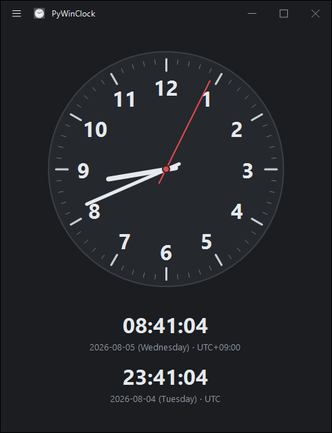
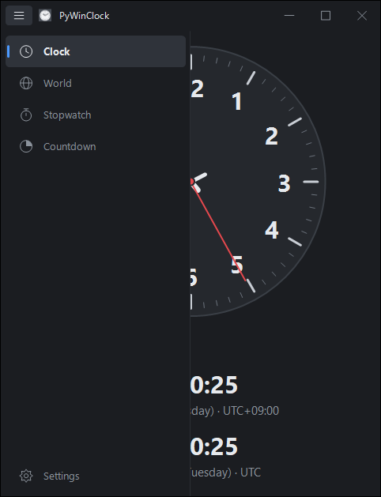
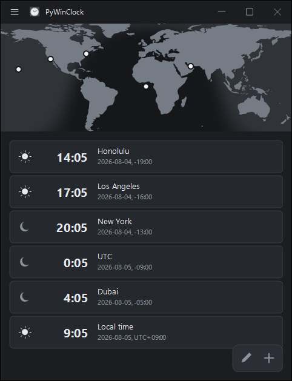
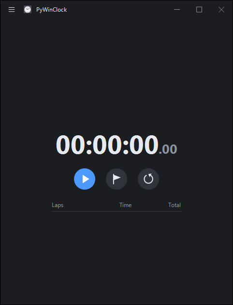
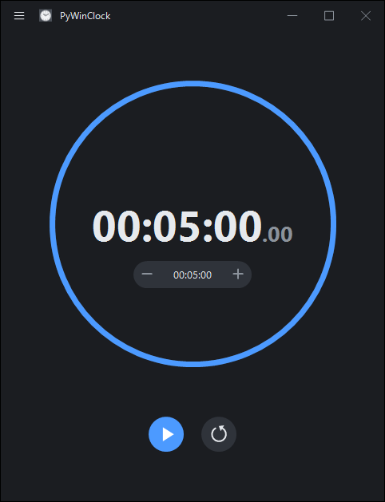
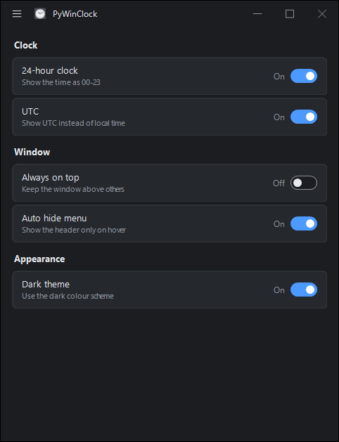

# PyWinClock

A Windows clock app drawn entirely on a wxPython canvas. Written as a replacement for
TimeKit, a UWP clock app that has been delisted from the Microsoft Store.

On a PC with Smart App Control enabled, a sideloaded MSIX cannot run without a trusted
signature. Running local sources directly through `pythonw.exe` is not subject to that
restriction, so this app is deliberately **not** packaged into a distributable build.








## Features

- **Clock** — analog dial rendered with `wx.GraphicsContext` (smooth sweeping second hand),
  digital readout, `2026-08-03 (Monday) · UTC+09:00` date line
- **World** — an equirectangular map with the daylight side lit and a dot per city, over a
  list of times with the date and the offset from local time as `±HH:MM`. Each row carries
  a sun or a moon from the actual solar elevation there. Map and list point at each other:
  hovering a dot outlines its row in the accent colour, and hovering a row grows its dot.
  A toolbox floats at the bottom right: the plus adds a city (search by name or time zone),
  the pencil turns on editing so every removable row shows a cross.
- **Stopwatch** — start/pause, reset, and a `Laps / Time / Total` table that marks the
  fastest and slowest lap. Newest lap first, scrolls with the wheel.
- **Countdown** — progress ring over a rounded `HH:MM:SS` field with a minus and a plus
  sitting inside it, each press moving the time by a minute. The field takes digits and
  colons only and reads whatever is written — `90`, `0:0`, `01:30`, `00:01:30` all mean
  the same thing — then writes it back as `HH:MM:SS` once you leave it. Start/pause/reset
  below, and a blinking `DONE` with a beep at zero
- **Settings** — 12/24-hour, local/UTC (the dial follows it too), always on top, auto hide
  menu, dark theme. The last entry of the side menu, pinned to its bottom.

Both timers read `00:00:00.00` on one line, with the hundredths set smaller and aligned to
the baseline of the large digits. Start / Lap / Reset are round icon buttons; the primary
one is filled with the accent colour and swaps between play and pause. Settings is a stack
of Windows 11 style cards — title, description and an On/Off switch — grouped under
`Clock`, `Window` and `Appearance`.

The window has no system caption. The app draws the whole header itself: a hamburger at the
left, the icon and the title beside it, and minimize / maximize / close at the right. The
caption strip that Windows still keeps above the client area is painted with the theme
background through `DWMWA_CAPTION_COLOR`, so nothing seams. That strip counts as part of
the header, so the hamburger, the title and the caption buttons are centred on the two
together rather than on the canvas alone. Dragging, snapping and edge
resizing stay native; only maximizing is done by hand, because a window without a caption
would otherwise spill past the screen and cover the taskbar.

Pages are chosen from the side menu the hamburger opens. It slides in over the page, holds
the mouse while it is open so a click anywhere else dismisses it, and closes on `Esc`.

The header stays hidden until the pointer is over the window, so the clock face is
uninterrupted while idle. It keeps its space rather than collapsing, so nothing shifts when
it appears. It stays visible on the Settings page and while the menu is open, so there is
always a way back.

Dark and light themes cover the window frame too, via DWM immersive dark mode. Window size
and settings persist automatically, and only one instance runs at a time
(`wininstance.has_running_instance`).

Settings, including the chosen cities, are stored in `%APPDATA%\PyWinClock\settings.json`.

The map is drawn from `assets/map/land.json`, a reduced copy of the public domain Natural
Earth `ne_110m_land` polygons. `makemap.py` produces it; the downloaded original is not
kept in the repository. Time zones come from `zoneinfo` with the `tzdata` package.

Every control is drawn on canvas rather than using native widgets. Native `wx.Button`,
`wx.CheckBox`, `wx.ListCtrl` and `wx.adv.DatePickerCtrl` ignore background colours on
Windows and stay light in a dark theme, so they are replaced by `controls.RoundButton`,
`controls.SettingCard`, `stopwatchbox.LapList` and plain `wx.TextCtrl` fields. A
`wx.TextCtrl` cannot round its own corners either, so `countdownbox.FieldBox` draws the
rounded plate and seats the entry and its two step buttons inside it.

## Requirements

Python 3.13 with `wxPython`, `psutil`, `pywin32` and `tzdata`.

## Run

```
pythonw source\main.pyw
```

## Start menu entry

```
python source\makeicon.py
python source\makeshortcut.py
```

`makeshortcut.py` creates `Start Menu\Programs\PyWinClock.lnk` pointing at
`pythonw.exe "source\main.pyw"`. Remove that `.lnk` to uninstall.

## Layout

| File | Role |
| --- | --- |
| `source/main.pyw` | Entry point. Checks for a running instance, then calls `mainapp` |
| `source/mainapp.py` | `MainFrame`, page wiring, timer, theme and settings |
| `source/clockbox.py` | Analog clock canvas and clock tab |
| `source/worldbox.py` | World map, city list and city picker |
| `source/cities.py` | City table: name, time zone and coordinates |
| `source/stopwatchbox.py` | Stopwatch canvas, lap table and stopwatch tab |
| `source/countdownbox.py` | Countdown ring canvas and countdown tab |
| `source/settingsbox.py` | Settings page of cards, opened from the side menu |
| `source/titlebar.py` | Canvas-drawn title bar replacing the system caption |
| `source/sidemenu.py` | Sliding side menu opened by the hamburger |
| `source/icons.py` | Line glyphs for the title bar and the side menu |
| `source/controls.py` | Canvas-drawn buttons, round icon buttons and setting cards |
| `source/utilities.py` | `Canvas` base class, themes, fonts, settings, DWM frame |
| `source/wininstance.py` | Single instance check |
| `source/shortcut.py` | Shortcut helper |
| `source/makeshortcut.py` | Creates the start menu link |
| `source/makeicon.py` | Generates `assets/icon/icon.ico` |
| `source/makemap.py` | Generates `assets/map/land.json` from Natural Earth |
