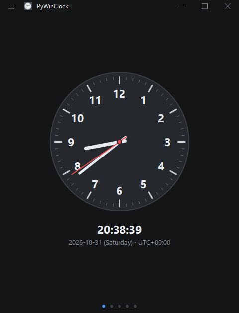
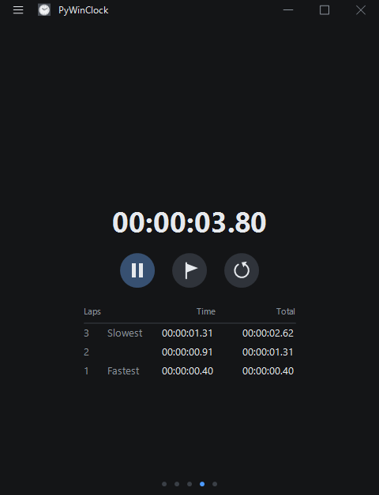
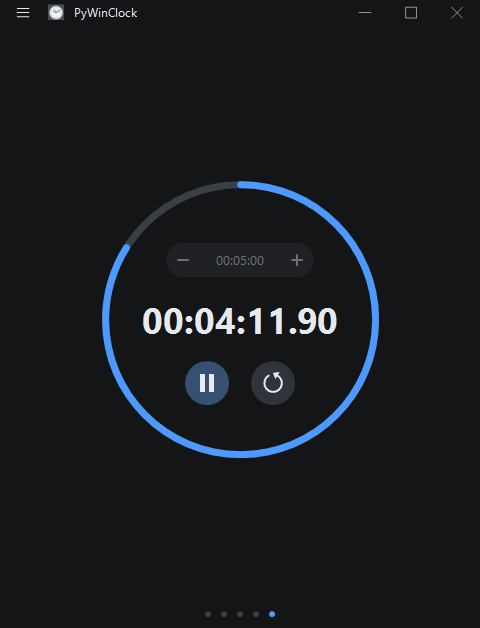

## Features

* Analog and digital clock. Turn on UTC in Settings and a Local / UTC switch under the time picks which one the dial and the digits show.
* World clock on a day and night map, with the UTC meridian and the date line. Cities are searched by name or time zone, and one of them can be set as home.
* Stopwatch with laps, marking the fastest and slowest.
* Countdown with a progress ring and a beep at zero. The ring changes colour for the last ten seconds.
* Weather for the home city from Open-Meteo: now, hourly, and the days around today.
* Drag a page sideways, or click the dots under it, to go between Clock, World, Weather, Stopwatch and Countdown. Each page but Clock can be turned off and reordered in Settings.
* Classic and minimal clock faces, smooth or ticking second hand.
* Auto, dark and light themes, with a blue or red accent.
* The title bar can stay hidden until the mouse is over the window, and the window can stay on top.
* A tray icon with Close to tray; the clock keeps running while hidden.
* World map from Natural Earth, public domain.

## Screenshot

  

## How to install

* Just download and install the latest release.
* Alternatively, if you like to build your own, download or clone a repository then execute makebuild.py. Python 3.x, Python packages in the requirements.pip file, PyInstaller and Inno Setup are required.
* To run from the source, install Python packages in the requirements.pip file, then execute source/main.pyw with pythonw.exe.
* Settings > Start menu > Create puts a shortcut in the Start menu.

## Supported platforms

* Microsoft Windows 11
